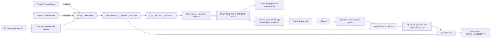

# As-built architecture

## Five roles, four business-oriented roles
`VERITY_V1_0_ADMIN` creates/maintains; `VERITY_V1_0_EXEC_DE_PIPELINE` SELECTs only approved project tables and executes DQ; `VERITY_V1_0_STEWARD` reviews and approves only through governed procedure; `VERITY_V1_0_VIEWER` reads outputs; `VERITY_V1_0_TASK_EXEC` is internal technical Task owner. Project roles must never inherit OWNER/Admin by convenience.

## Table inventory (ten confirmed)
- CONFIG: DQ_SOURCE; DQ_RULE_CATALOG
- MONITORING: DQ_METRIC_HISTORY
- RESULTS: DQ_RUN; DQ_RULE_RESULT; DQ_RULE_APPROVAL_AUDIT; DQ_RULE_NOTIFICATION_LOG; DQ_APPROVAL_VALIDATION_QUEUE; DQ_POST_LOAD_RUN; DQ_VALIDATION_RECOVERY_AUDIT

## Additional object inventory
- View `MONITORING.V_DQ_PROFILE_EVIDENCE`.
- Stream `RESULTS.ST_DQ_RULE_ACTIVATIONS`.
- Task `ENGINE.TK_DQ_VALIDATE_APPROVED_RULES` (1 MINUTE, SUSPENDED at export unless explicitly resumed).
- Programmatic Cortex `AI_COMPLETE` inside `SP_DQ_GENERATE_AI_RECOMMENDATIONS` (not the same as interactive Cortex Agent).
- Potential interactive `MONITORING.VERITY_AI_ASSISTANT`; existence must be verified.
- **Semantic views:** names and number not yet confirmed. Discover via `SHOW SEMANTIC VIEWS IN DATABASE VERITY_V1_0` and export exact DDL; don't invent a semantic view as a substitute.
- Email integration: earlier design says `VERITY_V1_0_EMAIL_INT`; verify actual `SHOW NOTIFICATION INTEGRATIONS` and `DESCRIBE INTEGRATION`.

## Deployment guarantees and limitations
Original procedure bodies reference `VERITY_V1_0` explicitly. This initial migration targets same object names in a new account. Only role/schema/table DDL and config examples are included until exported. Real cross-project visibility and independent project testing still require explicit grant verification. Production-hardening and source-authorization checks are release blockers, even if a functional pilot succeeded.
